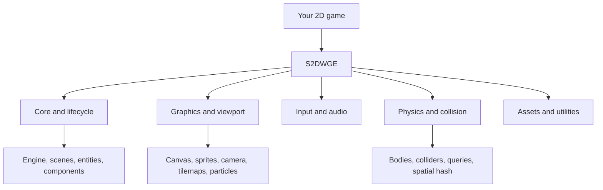

<div align="center">
  <h1>🎮 S2DWGE</h1>
  <h3>Shreyas's 2 Dimensional Web Game Engine</h3>
  <p>A modular, JavaScript-based 2D game engine for the web, powered by HTML5 Canvas and ES modules.</p>
  <p><em>Understand the systems. Build the engine. Bring your game worlds to life.</em></p>
  <p>
    
    
    
    
  </p>
  <p>
    <a href="#-overview">Overview</a> ·
    <a href="#-features">Features</a> ·
    <a href="#-getting-started">Getting started</a> ·
    <a href="#-create-your-first-game">Create a game</a> ·
    <a href="#-development-and-tests">Development</a> ·
    <a href="#-release-status">Release status</a>
  </p>
</div>

---

## ⚠️ Educational Use Only — No Copying Allowed

This repository is **public for educational viewing and technical study**. You may inspect the source code to understand the engine's architecture, logic, mathematics, and general programming concepts.

|   | **Action**                                                                  | **Permission**                        |
| - | --------------------------------------------------------------------------- | ------------------------------------- |
| ✅ | View and study the public source code to learn how the engine is structured | **Permitted**                         |
| ❌ | Copy or reproduce the source code, or paste it into another project         | **Requires prior written permission** |
| ❌ | Modify or redistribute the source code                                      | **Requires prior written permission** |
| ❌ | Incorporate it into another engine, game, library, or product               | **Requires prior written permission** |

See [LICENSE](LICENSE) for the proprietary terms. No other permissions are granted by making this repository publicly viewable.

## 🧭 Overview

**S2DWGE (Shreyas's 2 Dimensional Web Game Engine)** is an independent, modular engine project for creating 2D games that run in modern web browsers. It is built with JavaScript, HTML5 Canvas, and native ES modules, with a focus on understandable systems, reusable components, and automated verification.

The project provides building blocks for game loops, scenes, entities and components, rendering, input, animation, audio, asset loading, collision detection, and physics utilities. Use the included examples and starter template as a foundation, then shape the game logic and presentation to fit your project.

> **Release status:** `1.0.0-rc.2` — release candidate. The project has passed the CI checks listed below, but stable `1.0.0` has not been declared by this archive. Review [Release status](#-release-status) and `RELEASE_CHECKLIST.md` before shipping.

## ✨ Features

| Area | Included systems |
|---|---|
| **Core** | Engine lifecycle, scenes, entities, components, events, timers, tweens, logging, profiling, and storage utilities |
| **Rendering** | HTML5 Canvas rendering, sprites, animation, camera and viewport utilities, text helpers, tilemaps, and particles |
| **Input** | Keyboard input and pointer tracking for browser games |
| **Physics and collision** | Physics bodies, colliders, collision queries, filtering, and spatial-hash broad-phase utilities |
| **Assets and audio** | Asset loading and browser audio management |
| **Developer experience** | ES-module architecture, starter/sample games, API documentation, unit tests, and cross-browser Playwright tests |

Feature availability and behavior are defined by the current implementation and documented limitations. In particular, do not assume S2DWGE is a full-featured general-purpose rigid-body physics engine; review `docs/API_REFERENCE.md` and the relevant source before depending on specific collision or solver behavior.

## 🏗️ Architecture

The engine is split into focused modules so systems can be explored, tested, and extended independently.



See [`docs/API_REFERENCE.md`](docs/API_REFERENCE.md) for the public named exports and subsystem notes. See [`docs/DEPLOYMENT.md`](docs/DEPLOYMENT.md) for hosting guidance.

## 🛠️ Requirements

- **Node.js 18 or newer** (Node.js 20 or 22 are also covered by the configured CI matrix).
- **npm**, included with Node.js.
- A modern browser with HTML5 Canvas and ES-module support.

## 🚀 Getting started

### 1. Get the source

```bash
git clone https://github.com/Shreongit/Shreyas.2.Dimensional.Web.Game.Engine.git
cd Shreyas.2.Dimensional.Web.Game.Engine
```

### 2. Install dependencies

```bash
npm ci
```

This installs the development dependencies from the lockfile. A successful setup requires the command to finish successfully; if the npm registry is unreachable, restore network access and retry.

### 3. Start the local demo server

```bash
npm run serve
```

Open the URL printed in the terminal (by default, `http://localhost:5173`). The server redirects the root page to the `examples/box-mover/` demo. Use HTTP rather than opening an HTML file directly with `file://`, because browser ES-module loading expects a web server.

### 4. Try the included games

- **Repository demo:** `examples/box-mover/`
- **Starter template:** `templates/starter-game/`
- **Generated starter game:** `dist/starter-game/` (after building)
- **Generated sample game:** `dist/sample-game/` (after building)

Build the generated distribution with:

```bash
npm run build
```

Then serve the repository or `dist/` directory using an HTTP server and open the appropriate game path. The built sample game is available at `/sample-game/` when serving `dist/` as the web root.

## 🎮 Create your first game

The recommended starting point is `templates/starter-game/`. Copy the template into your own project and customize `index.html`, `style.css`, and `game.js`. Keep the relative module paths intact, or update them consistently if you reorganize the files.

The starter demonstrates creating an engine, registering a scene, adding an entity and component, moving a player using keyboard input, and restarting the game. Its imports use the template's bundled engine path; the public package API and supported exports are documented in `docs/API_REFERENCE.md`.

For example, the public API can be imported from the package when it is installed in a consumer project:

```js
import { Engine, Scene, Entity, Component } from "s2dwge";
```

For a repository checkout, consult the API reference for the correct relative import path. This snippet illustrates the package's named-export style; it is not a complete runnable game by itself.

## 🧪 Development and tests

Run the syntax checks and unit/regression suite:

```bash
npm run ci
```

Run the other configured verification tasks individually:

```bash
npm run build:check
npm run test:api
npm run test:soak
npm run test:consumer
```

Run browser tests:

```bash
npx playwright install
npm run test:browser
```

Run the benchmark utility:

```bash
npm run benchmark
```

`npm run test:browser` uses Playwright and its configured browser projects. Browser binaries must be installed first. `npm run test:consumer` checks that a packed package can be installed into an isolated temporary consumer and that key exports can be imported. A passing test suite is evidence for the scenarios it covers, not a guarantee that every game, browser version, or workload will behave identically.

## 📁 Project layout

```text
S2DWGE/
├── .github/workflows/       # GitHub Actions CI
├── docs/                    # API, deployment, and release verification docs
├── examples/                # Repository demos
├── scripts/                 # Serve, build, checks, benchmark, consumer smoke test
├── src/                     # Engine source and public entry point
├── templates/               # Starter-game template
├── tests/                   # Unit, API, lifecycle, and distribution tests
├── dist/                    # Generated distribution and sample games
├── CHANGELOG.md
├── CONTRIBUTING.md
├── LICENSE
├── package.json
├── RELEASE_CHECKLIST.md
├── RELEASE_STATUS.md
└── SECURITY.md
```

The `dist/` directory is generated output. If you change source files, run `npm run build` and review the resulting distribution before packaging a release.

## 📚 Documentation

- [`docs/API_REFERENCE.md`](docs/API_REFERENCE.md) — public exports, subsystem overview, and lifecycle guidance.
- [`docs/DEPLOYMENT.md`](docs/DEPLOYMENT.md) — static hosting and deployment guidance.
- [`CHANGELOG.md`](CHANGELOG.md) — recorded project changes and release history.
- [`RELEASE_STATUS.md`](RELEASE_STATUS.md) — current release-candidate verification status.
- [`RELEASE_CHECKLIST.md`](RELEASE_CHECKLIST.md) — remaining release gates.
- [`CONTRIBUTING.md`](CONTRIBUTING.md) — contribution guidance.
- [`SECURITY.md`](SECURITY.md) — security reporting guidance.

## ✅ Release status

The maintainer-provided GitHub Actions screenshot shows all six push checks passing:

- Chromium browser tests
- Firefox browser tests
- WebKit browser tests
- Unit-test matrix for Node.js 18
- Unit-test matrix for Node.js 20
- Unit-test matrix for Node.js 22

Local verification recorded for this release-candidate archive also includes syntax/unit checks, distribution checks, API-contract checks, lifecycle soak checks, packed-consumer validation, package dry-run, and a 27-test browser run. See `RELEASE_STATUS.md` for the scope and qualifications of that evidence.

Before declaring stable `1.0.0`, complete the network-enabled clean install and dependency audit, review documented limitations and remaining checklist items, rebuild and rerun checks after release metadata changes, and obtain maintainer sign-off. **Passing CI does not, by itself, mean the stable release has been published.**

## 🤝 Contributing

Bug reports, reproducible issues, and focused improvements are welcome. Please read [`CONTRIBUTING.md`](CONTRIBUTING.md), include reproduction steps for bugs, and add tests for changed behavior where practical.

## 🔐 Security

For security-related concerns, follow the instructions in [`SECURITY.md`](SECURITY.md).

## 📄 License

S2DWGE is proprietary software. Public availability permits educational viewing and technical study only. Read the repository's [`LICENSE`](LICENSE) file for the applicable terms.

---

<div align="center">
  <strong>S2DWGE</strong><br />
  <em>Understand the engine. Build the game. Create your world.</em>
</div>
