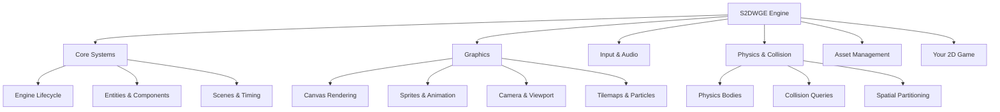

# 🎮 S2DWGE

<h3 align="center">Shreyas's 2 Dimensional Web Game Engine</h3>

<p align="center">
  A modular 2D game engine built from scratch with JavaScript and HTML5 Canvas.
</p>

<p align="center">
  <em>Understand the systems. Build the engine. Bring your game worlds to life.</em>
</p>

<p align="center">
  
  
  
  
  
</p>

<p align="center">
  <a href="#-overview">Overview</a> •
  <a href="#-architecture">Architecture</a> •
  <a href="#-features">Features</a> •
  <a href="#-getting-started">Getting Started</a> •
  <a href="#-development">Development</a> •
  <a href="#-roadmap">Roadmap</a>
</p>

---

## 📦 API contract and deployment

The named exports are listed in [`docs/API_REFERENCE.md`](docs/API_REFERENCE.md). The API reference is an inventory of the current release-candidate surface, not a promise that every subsystem has finalized semantic-versioning guarantees. Run `npm run test:api` to check that the documented symbols still exist.

For static hosting, module MIME types, HTTPS, Content Security Policy guidance, and deployment checks, see [`docs/DEPLOYMENT.md`](docs/DEPLOYMENT.md).

## 🧭 Overview

**S2DWGE** is an independent 2D game-engine project designed to provide reusable systems for building browser-based games.

Instead of being tied to a single game, S2DWGE aims to provide a modular foundation for different gameplay styles, from arcade experiences and platformers to top-down adventures and experimental prototypes.

The engine brings together core game-development concepts such as rendering, entities, components, scenes, input, animation, audio, physics, collision detection, tilemaps, and particles.

> 💡 **Design philosophy:** Build each subsystem deliberately, test its behavior, and keep the architecture understandable, extensible, and maintainable.

> ⚠️ **Current status:** Release candidate. APIs and subsystem capabilities may evolve before the stable 1.0 release.

## 🏗️ Architecture

S2DWGE is organized into focused modules that separate engine responsibilities and make the codebase easier to develop and test.



The diagram represents the intended high-level organization; individual utilities may not all be connected directly to the main engine loop.

## ✨ Features

<table>
  <tr>
    <td width="50%">
      <h3>🎨 Graphics & Rendering</h3>
      <ul>
        <li>HTML5 Canvas 2D rendering</li>
        <li>Sprite and animation systems</li>
        <li>Camera and viewport utilities</li>
        <li>Tilemap rendering</li>
        <li>Particle effects</li>
        <li>Canvas text helpers</li>
      </ul>
    </td>
    <td width="50%">
      <h3>⚙️ Core Architecture</h3>
      <ul>
        <li>Modular ES architecture</li>
        <li>Entity-component structure</li>
        <li>Scene management</li>
        <li>Timers and event utilities</li>
        <li>Logging and profiling utilities</li>
        <li>Reusable engine subsystems</li>
      </ul>
    </td>
  </tr>
  <tr>
    <td width="50%">
      <h3>🧱 Physics & Collision</h3>
      <ul>
        <li>Bounding-box collision utilities</li>
        <li>Circle and point collision queries</li>
        <li>Physics bodies and colliders</li>
        <li>Impulse and gravity support</li>
        <li>Collision filtering</li>
        <li>Spatial-hash broad phase</li>
      </ul>
    </td>
    <td width="50%">
      <h3>🎮 Input, Audio & Assets</h3>
      <ul>
        <li>Keyboard and pointer input</li>
        <li>Audio-management utilities</li>
        <li>Image and audio loading support</li>
        <li>Asset reuse across game systems</li>
        <li>Browser-based execution</li>
        <li>Automated testing infrastructure</li>
      </ul>
    </td>
  </tr>
</table>

*Feature availability and behavior depend on the current implementation. See the source and release notes for subsystem limitations.*

## 🛠️ Technology Stack

| Technology | Purpose |
|---|---|
| JavaScript | Engine implementation |
| HTML5 Canvas | 2D rendering |
| ES Modules | Modular code organization |
| Node.js | Development and testing |
| npm | Dependency and script management |
| Playwright | Browser-test infrastructure |
| GitHub Actions | Continuous integration |

## 🚀 Getting Started

### Prerequisites

- Node.js 18 or newer
- npm
- A modern browser with HTML5 Canvas and ES-module support

### Installation

Clone the repository:

```bash
git clone https://github.com/Shreongit/Shreyas.2.Dimensional.Web.Game.Engine.git
cd Shreyas.2.Dimensional.Web.Game.Engine
```

Install the development dependencies:

```bash
npm install
```

Start the local development server:

```bash
npm run serve
```

Open the local address printed in your terminal and navigate to the BoxMover Arena example if it is not opened automatically.

### Your First Game

S2DWGE is intended to support reusable game projects rather than a single fixed game. A typical project will initialize the engine, create scenes, add entities and components, load assets, process player input, and render gameplay.

For the exact initialization sequence and public APIs, start with the working example and the corresponding source modules. API stability is not guaranteed for every subsystem yet.

## 🧪 Development

Run the configured local checks:

```bash
npm run ci
```

Run unit tests:

```bash
npm test
```

Run browser tests when the browser-test dependencies are installed:

```bash
npx playwright install
npm run test:browser
```

Run the benchmark if included in your checkout:

```bash
npm run benchmark
```

Test results validate the scenarios covered by the suite. They do not guarantee that every possible game, browser, physics interaction, or workload is supported.

## 📁 Project Structure

```text
S2DWGE/
├── .github/
│   └── workflows/
├── examples/
│   └── box-mover/
├── scripts/
├── src/
├── tests/
├── CONTRIBUTING.md
├── LICENSE
├── README.md
├── RELEASE_CHECKLIST.md
└── SECURITY.md
```

The `src/` directory contains the engine implementation, `examples/` demonstrates its use, and `tests/` contains automated checks.

## 🗺️ Roadmap

- [x] Modular engine foundation
- [x] Core graphics and input systems
- [x] Physics and collision utilities
- [x] Automated test and CI infrastructure
- [ ] Complete physics edge-case validation
- [ ] Validate viewport and rendering behavior across device-pixel ratios
- [ ] Establish repeatable performance and memory baselines
- [ ] Finalize stable public APIs
- [ ] Complete the 1.0 release checklist

## 🤝 Contributing

Contributions, bug reports, and focused feature proposals are welcome.

Please read [CONTRIBUTING.md](CONTRIBUTING.md) before submitting changes. Include reproduction steps for bugs and tests for changed behavior.

## 🔐 Security

For security-related concerns, consult [SECURITY.md](SECURITY.md).

## 📄 License

See the repository's [LICENSE](LICENSE) file for the applicable terms and permissions.

---

<p align="center">
  <strong>S2DWGE</strong><br />
  <em>Understand the engine. Build the game. Create your world.</em>
</p>


### Complete sample game

The generated `dist/sample-game/` folder contains Starfall Survival, a small playable example demonstrating custom components, keyboard input, dynamic entities, collision/game-over handling, pause, and restart. Build with `npm run build`, serve `dist/` over HTTP, and open `/sample-game/`.
